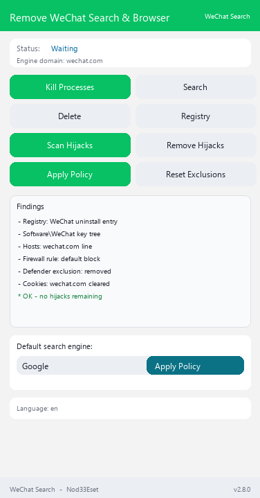

# AntiWeChat Vanced

**🇬🇧 English** | [🇷🇺 Русский](README.ru.md) | [🇺🇦 Українська](README.uk.md) | [🇰🇿 Қазақша](README.kk.md) | [🇩🇪 Deutsch](README.de.md) | [🇫🇷 Français](README.fr.md) | [🇪🇸 Español](README.es.md) | [🇵🇱 Polski](README.pl.md) | [🇹🇷 Türkçe](README.tr.md) | [🇨🇳 中文](README.zh.md)

## 🌐 Forks

[AntiBaiduVanced](https://github.com/retvil/AntiBaiduVanced)  |  [AntiSogouVanced](https://github.com/retvil/AntiSogouVanced)  |  [Anti2345Vanced](https://github.com/retvil/Anti2345Vanced)  |  [AntiUCWebVanced](https://github.com/retvil/AntiUCWebVanced)  |  [AntiNaverVanced](https://github.com/retvil/AntiNaverVanced)  |  [AntiKakaoVanced](https://github.com/retvil/AntiKakaoVanced)  |  [AntiQQVanced](https://github.com/retvil/AntiQQVanced)  |  **AntiWeChatVanced**  |  [AntiTencentVideoVanced](https://github.com/retvil/AntiTencentVideoVanced)  |  [AntiVKGroupVanced](https://github.com/retvil/AntiVKGroupVanced)  |  [AntiYandexVanced](https://github.com/retvil/AntiYandexVanced)

## 这是什么？

WeChat 安装的不只是一个浏览器 — 它通过四十种不同的系统机制悄悄把自己注册为默认搜索和默认浏览器：注册表关联、企业策略、浏览器配置文件设置，甚至 Chromium 配置文件内部的搜索引擎数据库。仅删除浏览器并不能撤销这一切。

**AntiWeChat Vanced**（[TheCawa/AntiYandex](https://github.com/TheCawa/AntiYandex) 的 fork）会找出**全部 28 个向量 (VANCED) / 39 (EXTENDED)**，一键清除它们，然后通过 Windows 企业策略**将默认搜索硬性锁定**到你选择的搜索引擎 — 让任何东西都无法悄悄改回去。

## 功能

- **劫持扫描器** — 检测 28 个向量 (VANCED) / 39 个向量 (EXTENDED)：安装路径、注册表 Uninstall 项、`UserChoice` 关联、`StartMenuInternet` 注册、`Software\WeChat` 键树、通过 `DefaultSearchProvider*` 策略的劫持、Chromium 配置文件的 `Preferences`、`Web Data`（SQLite）关键词、Firefox `search.json.mozlz4`、旧版 `SearchScopes`、自启动项、计划任务、Windows 服务、IME Switcher、文件关联、WeChat Disk 外壳集成、禁用的自启动、App Paths、快捷方式、ProgramData/Roaming 残留、hosts 条目、防火墙规则、URI 协议、浏览器扩展、wechat.ru cookies、“打开方式”关联、Prefetch/WER 痕迹、Defender 排除项、键盘布局、IE 起始页劫持、启动 URL 策略（`RestoreOnStartupURLs`）、Firefox 主页、IE 区域映射、RegisteredApplications 项、MUICache 痕迹、%TEMP% 安装程序、Store 应用（WeChat Music、Alice）、产品目录、本地数据目录、WeChat.DNS
- **一键清除** — 每个向量都有专属 remover；被锁定的数据库会如实报告，不会崩溃
- **硬性搜索策略** — 通过 HKLM 策略（Chrome、Edge、Brave、Vivaldi、Opera 和 WeChat 浏览器）以及 Firefox/Waterfox 的 `policies.json`，将默认搜索锁定为 10 个搜索引擎之一（Google、Bing、DuckDuckGo、Brave Search、Startpage、Mojeek、Qwant、Ecosia、Yahoo、SearXNG）
- **策略清理** — 从注册表中清除 WeChat 的 `DefaultSearchProvider*` 值
- **10 种界面语言** — ru、en、uk、kk、de、fr、es、pl、tr、zh；自动检测系统语言
- **轻量界面** — ttkbootstrap，垂直布局，固定的状态栏和页脚

## 截图

<details>
<summary>主窗口</summary>



</details>

## 现成构建

从 [Releases](https://github.com/retvil/AntiWeChatVanced/releases) 下载：

- **Windows** — `AntiWeChatVanced.exe`（便携版，单文件，约 35 MB） — 移除 WeChat 浏览器和 WeChat 搜索
- **Windows** — `AntiWeChatExtended.exe`（便携版，单文件，约 35 MB）— 移除所有 WeChat 产品（WeChat Disk、IME Switcher 历史、全系统痕迹、Store 应用、WeChat.DNS）

请**以管理员身份**运行 — HKLM 策略和注册表清理需要提升的权限。

## 从源码安装

需要 Python 3.10+（[python.org](https://python.org)）。

```bash
git clone https://github.com/retvil/AntiWeChatVanced.git
cd AntiWeChatVanced
pip install psutil ttkbootstrap
python main.py
```

构建自己的 EXE：运行 `build.bat`（PyInstaller，输出在 `dist/`）。

## 使用方法

1. **结束进程** → **搜索 WeChat** → **删除 WeChat** — 移除浏览器本身。
2. **扫描搜索劫持** — 列出 WeChat 在系统中扎根的所有方式。
3. **删除劫持** — 先关闭所有浏览器，然后清除所有发现的项目。
4. 选择一个引擎 → **应用策略** — 默认搜索已在系统层面锁定。

## 常见问题

- **为什么需要管理员？** 搜索策略位于 HKLM，劫持清理会触及系统注册表 — 需要提升权限。
- **结果中出现「Database locked」？** 清理时有 Chromium 浏览器正在运行。关闭所有浏览器后重新执行删除。
- **如何撤销搜索策略？** **移除 WeChat 策略**按钮会清除策略值；Firefox 用户还可以删除 `distribution\policies.json` 文件。

## 作者与支持

Автор: **Nod33Eset**. Изначальная идея: [TheCawa/AntiYandex](https://github.com/TheCawa/AntiYandex). Мы уже ушли далеко от простого форка.

如果这个工具帮你摆脱了 WeChat，可以支持一下开发：

**加密货币：**

- BTC: `bc1qunld3rsp37qf5gg69aune50y0qqkd0eugg7j97`
- TON: `UQDmvr4SKOxSION3Yky6aOgzAnCDXySPuAbG4EKJa5JUT7tC`
- USDT (TRC20): `TBPJSSLu1mUcX54g9UyxUohYGf2fuRvbwd`
- USDT (ERC20): `0x25CAED3776Ef5b18E03392bC5b254Bbd78E8180C`
- USDT (SOL): `3qgN5z291CEcj2FUi2Zza5DioxKgNw72kC7P52pCcTrG`

## 许可证

MIT — 见 [LICENSE](LICENSE)。


